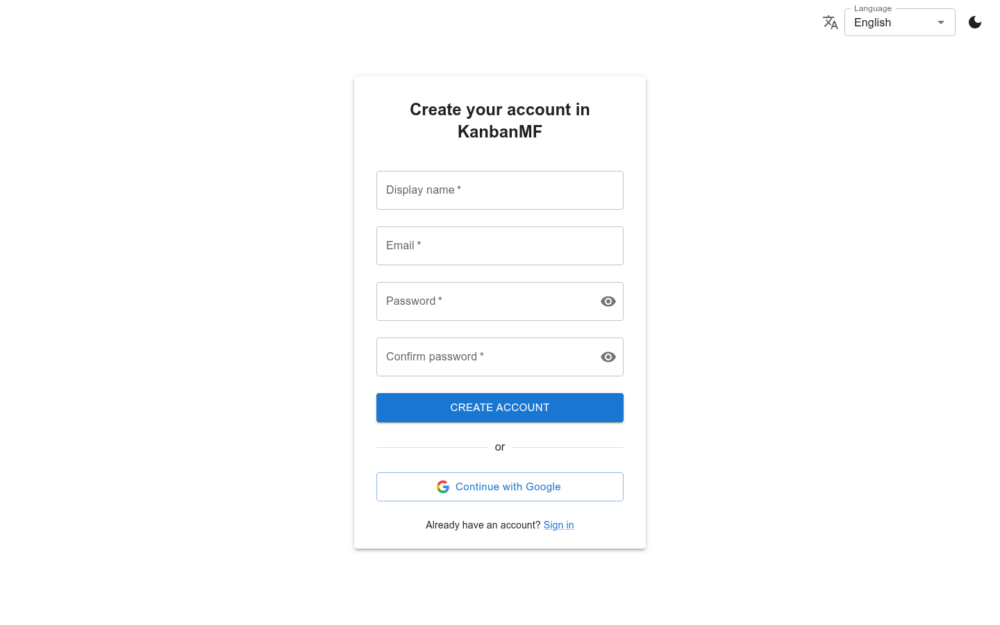
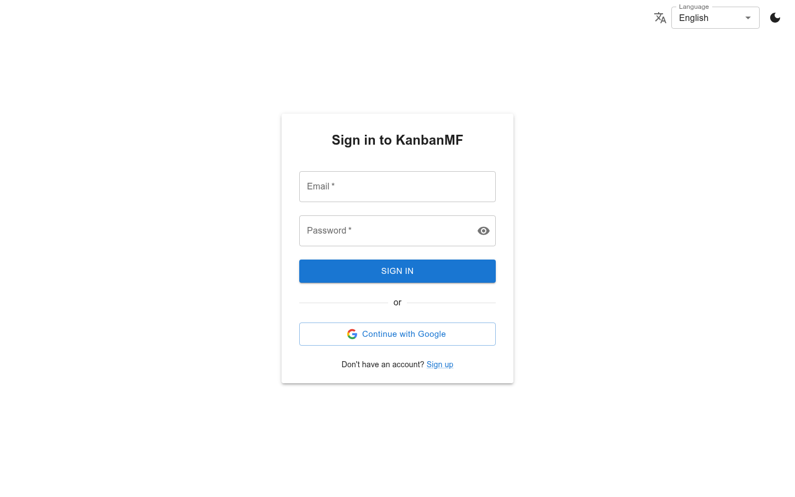
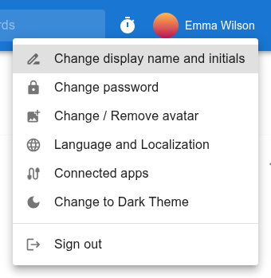

Accounts and signing in
=======================

Creating an account
-------------------

Open the sign-up page — the **Sign up** link under the sign-in form — and
fill in a display name (the name other people will see), your e-mail address
and a password, twice.

   Creating an account.

Use the **Language** box at the top right to pick English or Catalan first:
the account starts in the language the page is shown in, and the
verification e-mail is written in it too. You can change it later in your
:doc:`preferences`.

After **Create account**, KanbanMF sends you an e-mail with a verification
link. Click it to activate the account; until then you can't sign in. The
link is valid for 24 hours — if it expires, sign up again to get a new one.

If someone invited you
~~~~~~~~~~~~~~~~~~~~~~

When a board's owner invites you by e-mail (see :doc:`sharing`), the
invitation contains a sign-up link. The sign-up page then says who invited
you to which board. Create the account **with the address the invitation was
sent to**; as soon as you verify it, the board appears under
:guilabel:`Shared with me`, with nothing else to do.

An invitation is valid for 30 days. If the page says the link is no longer
valid, the invitation has expired or was cancelled: you can still create an
account, but ask the owner to share the board with you again.

Signing in
----------

   Signing in.

Sign in with your e-mail address and password, or with **Continue with
Google**. Google accounts need no verification e-mail. If you already have an
account with the same address, signing in with Google leads to that same
account — both ways of signing in work from then on.

The Google button is always shown, but it only works if whoever runs your
KanbanMF server has set Google sign-in up. If it fails, ask them, or use an
e-mail address and password instead.

Your profile
------------

Click your name in the top bar to open the user menu.

   The user menu.

Change display name and initials
   Your display name is shown on boards you share, on cards and in the share
   dialog. Your initials (up to three letters or digits) appear in your round
   avatar when you have no picture; leave the box empty to use the first
   letter of each word of your display name.

   .. figure:: img/display-name.png
      :alt: The dialog to change the display name and initials.

Change password
   Asks for your current password and the new one, twice. An account that
   only ever signed in with Google has no password here to change.

Change / Remove avatar
   Upload a picture to use instead of your initials, or remove the current
   one. JPEG, PNG, WebP and GIF are accepted, up to 100 KB.

Language and Localization, and the theme
   See :doc:`preferences`.

Connected apps
   The apps, such as Claude, you have allowed to reach some of your boards.
   See :doc:`claude`.

Signing out
-----------

KanbanMF keeps you signed in on each browser and device you use, so you
don't have to type your password every time. If you don't use it on a device
for 30 days, you will have to sign in again there.

**Sign out** — the last item of the user menu, or the icon at the right of
the top bar — signs you out of the browser you are using. You stay signed in
on your other devices.
