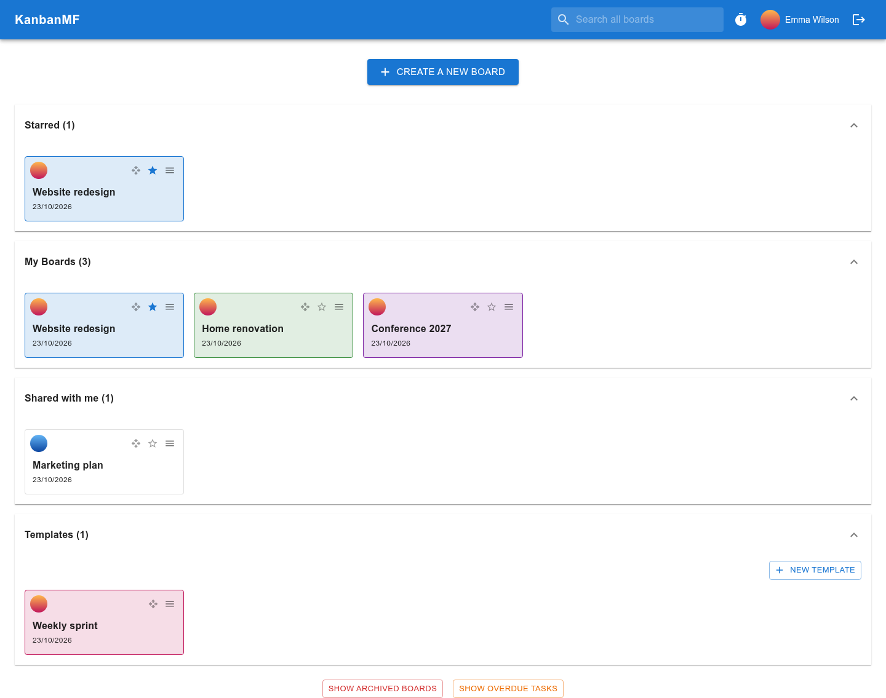
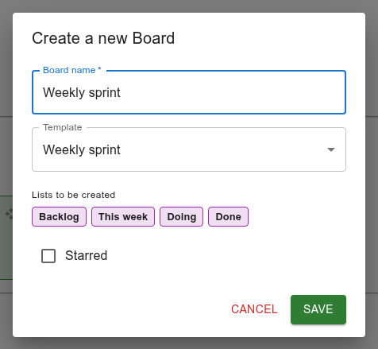
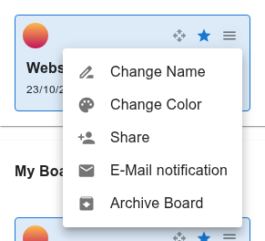
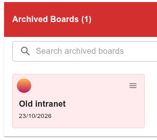
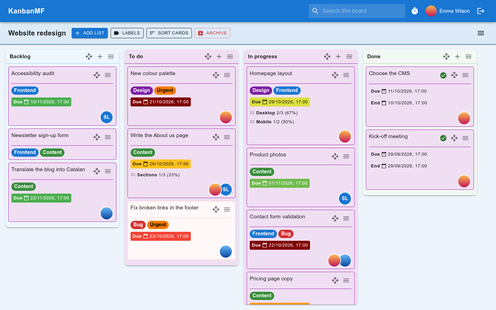
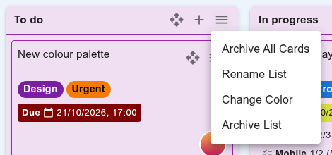
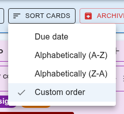
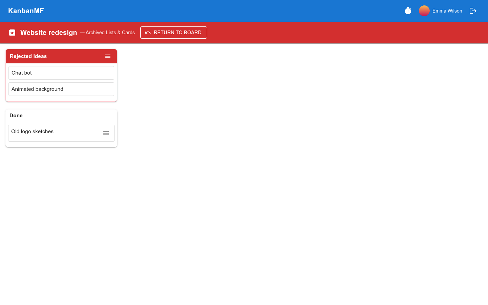

Boards and lists
================

The boards overview
-------------------

The boards overview is the first screen after signing in. Click
**KanbanMF** in the top bar to come back to it from anywhere.

   The boards overview.

Boards are grouped in sections:

:guilabel:`Starred`
   The boards you starred, for quick access. A starred board appears both
   here and in its own section.

:guilabel:`My Boards`
   The boards you created.

:guilabel:`Shared with me`
   Boards other people created and shared with you. The round avatar on each
   tile shows its owner.

:guilabel:`Templates`
   Starting points for new boards — see :doc:`templates`.

Click a section's title to fold it away; KanbanMF remembers which sections
you folded, in this browser. At the bottom of the page,
:guilabel:`Show Archived Boards` lists the boards you archived and
:guilabel:`Show Overdue Tasks` opens the :doc:`overdue tasks <overdue>` page.

The order, the stars and the colours are **yours alone**: someone you share a
board with can star it, colour it and place it differently on their own
overview without affecting yours.

Creating a board
~~~~~~~~~~~~~~~~

Click :guilabel:`Create a new Board`, type its name and click **Save**. Tick
:guilabel:`Starred` to star it straight away.

         it will create.

   Creating a board from a template.

If you have templates, or someone shared one with you, the dialog also offers
a :guilabel:`Template`. Choose one to start the board with a copy of its
lists — the dialog previews them. Leave it on :guilabel:`None (empty board)`
for a board with no lists.

Starring and reordering
~~~~~~~~~~~~~~~~~~~~~~~

Click the star on a board's tile to star it, and again to unstar it. To
change the order of the boards in a section, drag a tile by its four-arrow
handle and drop it where you want it.

The board menu on the overview
~~~~~~~~~~~~~~~~~~~~~~~~~~~~~~

Each tile has a menu (☰) at its top right.

   The menu of a board you own.

:guilabel:`Change Name`
   Rename the board. Owner only.

:guilabel:`Change Color`
   Pick the board's colour, or :guilabel:`Reset to default`. The colour tints
   the tile and the board itself, and is only what *you* see.

:guilabel:`Share`
   Share the board with other people — see :doc:`sharing`. Owner only.

:guilabel:`E-Mail notification`
   Your due-date reminders for this board — see :doc:`notifications`.

:guilabel:`Archive Board`
   Owner only; see below.

On a board shared with you, the menu only has the items you can use: the
colour and your e-mail notifications.

Archiving and deleting a board
------------------------------

Archiving hides a board from the overview — for you and for everyone it is
shared with — without losing anything. To see your archived boards, click
:guilabel:`Show Archived Boards` at the bottom of the overview.

   An archived board.

Each archived board's menu has :guilabel:`Restore Board`, which puts it back
where it was, and :guilabel:`Delete Board`, which deletes it permanently,
with its lists and cards. Deleting can't be undone, and a board can only be
deleted once it is archived.

Working on a board
------------------

Click a board's tile to open it.

   A board.

The bar under the board's name holds:

:guilabel:`Add List`
   Add a new list at the right end of the board.

:guilabel:`Labels`
   The board's labels — see :ref:`manual-labels`.

:guilabel:`Sort cards`
   How the cards are ordered in every list of the board — see
   :ref:`manual-sorting`.

:guilabel:`Archive`
   The board's archived lists and cards — see :ref:`manual-archive`.

The menu (☰) at the right of the bar has your :guilabel:`E-Mail notification`
settings for the board.

Lists
~~~~~

Each list's header has three controls: the four-arrow handle to drag the
list to another position, **+** to add a card to it (see :doc:`cards`), and
the list menu (☰).

   The list menu.

:guilabel:`Archive All Cards`
   Archive every card in the list in one go — handy for clearing out a
   *Done* list. The list itself stays.

:guilabel:`Rename List`
   Change the list's name.

:guilabel:`Change Color`
   The list's colour, again only for you. New cards you add to a coloured
   list take its colour.

:guilabel:`Archive List`
   Hide the list, with all its cards, from the board.

Everyone with access to the board can add, rename, reorder and archive
lists.

.. _manual-sorting:

Sorting cards
~~~~~~~~~~~~~

   The sort options.

:guilabel:`Custom order`
   The order you arrange by dragging cards. This is the default.

:guilabel:`Due date`
   Cards with no due date first — still in the order you dragged them into —
   then the dated ones, soonest first. Only the undated cards can be moved by
   hand; a dated card's place follows from its date.

:guilabel:`Alphabetically (A-Z)` and :guilabel:`Alphabetically (Z-A)`
   By card name.

The choice applies to every list of the board, and is remembered per board,
in this browser.

.. _manual-archive:

Archived lists and cards
~~~~~~~~~~~~~~~~~~~~~~~~

:guilabel:`Archive` in the board's bar shows what has been archived on the
board: archived lists, with their cards, and archived cards from lists that
are still on the board.

   Archived lists and cards.

Use a list's or a card's menu (☰) to :guilabel:`Restore` it to the board.
The board's owner can also delete it permanently from the same menu; that
can't be undone. :guilabel:`Return to Board` takes you back.
