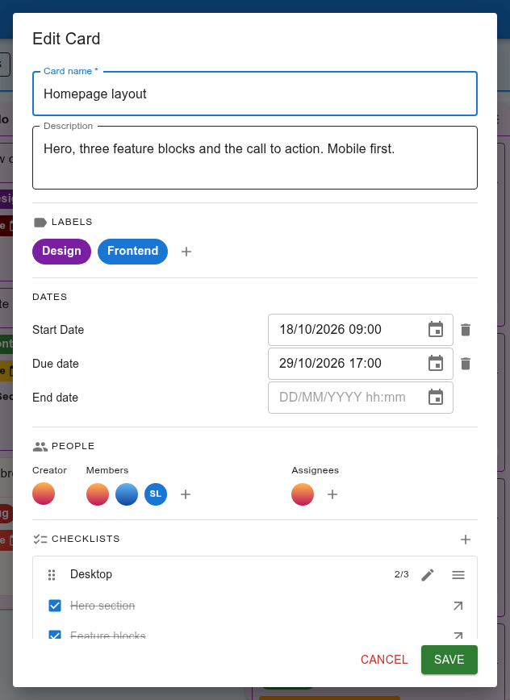
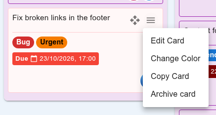
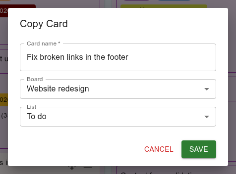
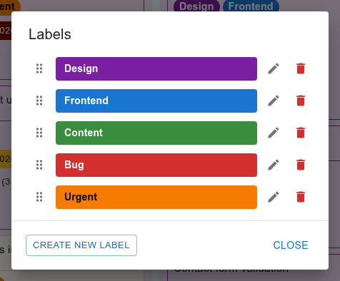

Cards, checklists and labels
============================

Creating a card
---------------

Click **+** in a list's header. The :guilabel:`Create Card` dialog opens:
only the name is required, and everything else can be added now or later.
Click **Save** to add the card. With the cards in their custom order (see
:ref:`manual-sorting`), a new card appears at the top of its list.

What a card shows
-----------------

.. figure:: img/board.png
   :alt: Cards on a board, with labels, coloured due dates, checklist
         progress and avatars.

   Cards on a board.

On the board, each card shows:

- its name, a four-arrow handle to drag it, and its menu (☰);
- its labels;
- its due date, coloured by how close it is (see below), and its end date
  once it has one;
- a line per checklist with how many items are done, such as
  *Desktop 2/3 (67%)*;
- the avatars of its assignees.

A card with an end date is finished: it shows a green tick, and its due date
is no longer coloured.

Due-date colours
~~~~~~~~~~~~~~~~

The due date changes colour as the day approaches:

- **green** with more than ten days to go;
- shading from **green to yellow** between ten and five days before;
- from **yellow to orange** in the last four days;
- **red** on the day itself;
- **dark red** once the date has passed.

Cards past their due date with no end date are also gathered on the
:doc:`overdue tasks <overdue>` page.

The card dialog
---------------

Click a card to open it, or choose :guilabel:`Edit Card` from its menu.

   The card dialog.

Card name and Description
   The description is free text, for whatever the name doesn't say.

:guilabel:`Labels`
   Click **+** to pick which of the board's labels the card has.

:guilabel:`Dates`
   Three optional dates, each with a date and a time. The *start date* is
   when work begins and must come before the end date. The *due date* is the
   deadline: it drives the colour on the card, the overdue tasks page and the
   e-mail reminders. The *end date* records when the card was finished, and
   marks it as done. The bin icon next to a date removes it.

:guilabel:`People`
   The *creator* is whoever made the card. Add *members* — the people
   involved — and *assignees* — the people responsible for it — with the
   **+** buttons. You can choose among the board's owner and the people it is
   shared with. Assignees are shown on the card's face, and only assignees
   can get :doc:`reminders <notifications>` about it.

:guilabel:`Checklists`
   See below.

Nothing is saved until you click **Save** — that includes ticking checklist
items in the dialog. **Cancel** discards every change.

Checklists
----------

In the card dialog, **+** next to :guilabel:`Checklists` opens the
:guilabel:`Create Checklist` dialog: give it a name, then type each item and
add it. Items can be reordered by their handle, and removed.

Each checklist in the card dialog shows how many items are done. Tick an item
to mark it done. Use the pencil to rename the checklist or edit its items,
and the handle to drag checklists into another order. The checklist's menu
(☰) has:

:guilabel:`Copy checklist to another card`
   Choose a board, a list and a card; the checklist, with its items, is
   copied there.

:guilabel:`Delete Checklist`
   Remove it from the card.

Turning a checklist item into a card
~~~~~~~~~~~~~~~~~~~~~~~~~~~~~~~~~~~~

Sometimes an item turns out to be a piece of work of its own. The arrow icon
at the end of an item opens :guilabel:`Extract to New Card`: choose the board
and list for the new card. Its name starts as the original card's name
followed by the item's text, so you can tell where it came from; change it if
you like.

The new card takes the original card's labels, dates, people and colour, but
not its description or checklists. The original item stays where it was —
tick it or remove it yourself if you no longer need it there.

The card menu
-------------

   The card menu.

:guilabel:`Edit Card`
   Open the card dialog.

:guilabel:`Change Color`
   Tint the card. As with boards and lists, the colour is only what you see.

:guilabel:`Copy Card`
   Make a copy, in any list of any board you have access to.

:guilabel:`Archive card`
   Hide the card from the board. Restore it from the board's
   :ref:`archive <manual-archive>`.

Copying a card
~~~~~~~~~~~~~~

   Copying a card.

The copy starts with the same name — change it in the dialog — then choose
the board and the list. The copy has the original's description, dates,
checklists and your colour. Labels and people are kept on the same board.
On another board, a label is dropped because each board has its own labels,
and so is anyone who doesn't have access to that board.

Moving cards
------------

Drag a card by its four-arrow handle to a new position in the same list, or
to another list. Under :ref:`some sort orders <manual-sorting>` the position
inside a list follows from the order chosen, and dragging only moves the card
to another list.

Cards can't be moved to another board; copy the card there and archive the
original instead.

.. _manual-labels:

Labels
------

Labels belong to a board: every board has its own set. Click
:guilabel:`Labels` in the board's bar to see them.

   A board's labels.

The board's owner manages them here: :guilabel:`Create New Label` (a name
and a colour), the pencil to edit one, the bin to delete it, and the handle
to drag them into another order. Everyone with
access to the board can attach the labels to cards, from the card dialog.
