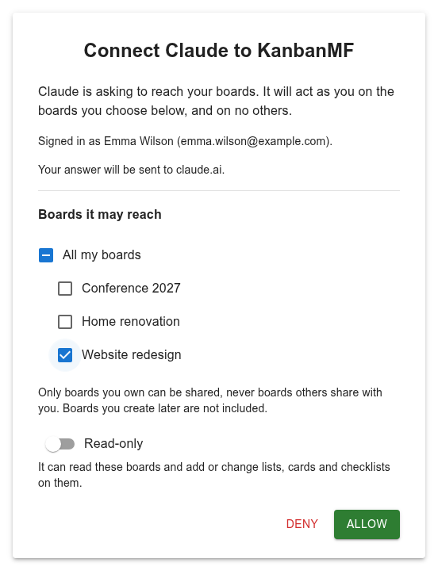
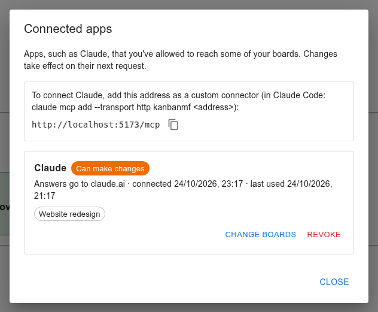

Connecting Claude
=================

You can let Claude, Anthropic's AI assistant, work with your boards: ask it
what is overdue, to sum up where a project stands, or to find the card where
you wrote something down — and, if you allow it, to add cards, move them
along, set due dates and tick off checklist items. KanbanMF speaks the *Model Context Protocol* (MCP),
the standard way for an assistant to use another application, so Claude
connects to it directly — there is nothing to install.

You stay in control of what it sees:

- Claude only reaches the boards **you choose** when you connect it, and only
  boards **you own** — never boards other people share with you. Boards you
  create later are not added on their own.
- You can make the connection **read-only**.
- You can change the boards, or cut the connection, at any time.

Claude signs in to KanbanMF with a connection of its own, not with your
password, and that connection only works for these requests: it can't be
used to sign in to the app.

With a connection that isn't read-only, Claude can create cards, change
their name, description, dates, labels and assignees, move them between lists,
archive and restore them, add lists, and add or tick checklist items. It can't
delete anything: to remove a card it archives it, and you (or Claude) can
restore it from the board's archive. Everything it changes appears straight
away for everyone with the board open, as if you had done it yourself.

Connecting
----------

You need your KanbanMF's address with ``/mcp`` at the end — for example
``https://kanban.example.com/mcp``. The user menu's
:guilabel:`Connected apps` shows it, with a button to copy it.

In Claude (web, desktop or mobile)
   Open :guilabel:`Settings`, then :guilabel:`Connectors`, and add a custom
   connector with that address. Then click :guilabel:`Connect` next to it.
   Custom connectors are available on the Claude plans that include them.

In Claude Code
   Run, in a terminal::

       claude mcp add --transport http kanbanmf https://kanban.example.com/mcp

   then type ``/mcp`` in Claude Code, choose *kanbanmf* and authenticate.

Either way, your browser opens KanbanMF. Sign in if you need to, and you
arrive at the page where you decide what Claude may reach.

         ticked and the Read-only switch.

   Choosing what Claude may reach.

Check the account you are signed in with and where the answer goes —
``claude.ai`` for Claude's apps. When the answer goes to a program on your own
computer, as with Claude Code, the page warns you: allow it only if you
started the connection yourself.

Tick the boards Claude may reach (:guilabel:`All my boards` ticks them all),
decide whether it is :guilabel:`Read-only`, and click :guilabel:`Allow`. Your
browser goes back to Claude, and the connection is ready. :guilabel:`Deny`
goes back without connecting.

Asking Claude
-------------

Just ask in your own words. For example:

- *What's overdue on my boards?*
- *Sum up where the Website redesign board stands.*
- *Which cards mention the invoice?*
- *What is on my plate this week?*
- *Add a card "Renew passport" to my Personal board, due next Friday, with a
  checklist: photos, form, appointment.*
- *Move the cards I finished today to Done.*

Claude finds the boards, lists and cards it needs by itself. It sees what you
would see on those boards — names, descriptions, dates, labels, people and
checklists — but not your time entries or anything outside the connection.
Dates you mention are understood in your own time zone (see
:doc:`preferences`). Before changing several cards at once, Claude tells you
what it is about to do.

Text on a card can be written by anyone you share the board with. Claude
treats it as information, not as instructions, but keep the connection
read-only if other people write on those boards and you'd rather not take the
chance.

Managing connections
--------------------

Choose :guilabel:`Connected apps` in the user menu to see every app you have
connected, when it was connected, when it last did something, and its boards.

   Connected apps.

:guilabel:`Change boards`
   Tick or untick boards, or switch :guilabel:`Read-only` on or off. The
   change counts from Claude's next request.

:guilabel:`Revoke`
   Cut the connection: Claude loses access straight away. Connect again
   from Claude whenever you want it back.

A board you archive drops out of every connection at once, and comes back
when you restore it; the list marks it *(archived)* meanwhile. A board you
delete is gone from every connection for good.
