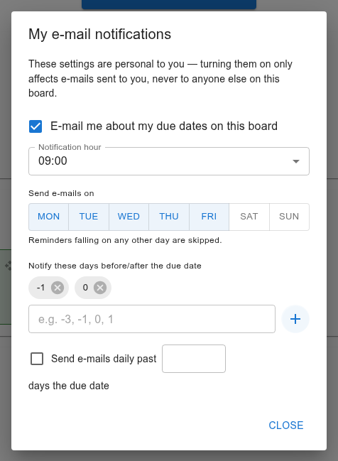

Due-date notifications
======================

KanbanMF can e-mail you about cards that are due soon or overdue. Reminders
are personal and per board: you decide for yourself, board by board, whether
you want them and when. Turning them on never subscribes anyone else.

Setting up your reminders for a board
-------------------------------------

Open the board's menu — on its tile in the boards overview, or the ☰ at the
right of the board's bar — and choose :guilabel:`E-Mail notification`.

   Reminders for one board.

Every change in this dialog is saved immediately; :guilabel:`Close` just
closes it.

:guilabel:`E-mail me about my due dates on this board`
   Turns your reminders for this board on or off. The other settings appear
   once it is on.

:guilabel:`Notification hour`
   The hour of the day the e-mails are sent, in your own time zone (see
   :doc:`preferences`).

:guilabel:`Send e-mails on`
   The days of the week e-mails may be sent on — Monday to Friday by default.
   A reminder that falls on any other day is skipped, not postponed.

:guilabel:`Notify these days before/after the due date`
   Type a number and click **+** to add it. Negative numbers are days
   *before* the due date, ``0`` is the day itself and positive numbers are
   days after it. For example ``-3``, ``-1`` and ``0`` remind you three days
   before, the day before, and on the day. Click the cross on a number to
   remove it.

:guilabel:`Send e-mails daily past … days the due date`
   Tick it and enter a number to keep getting a reminder every day once a
   card is that many days overdue, until it is finished.

Which cards you are reminded about
----------------------------------

Only cards on that board that:

- have you as an **assignee** — being a member is not enough;
- have a due date and **no end date** — once a card has an end date it is
  finished and the reminders stop;
- are not archived.

Each e-mail is about one card. Its subject names the card and the board and
says how the card stands — due in a number of days, due today, or a number
of days late — and it links to the board. It is written in your language.

You get at most one e-mail per card per day, even if several of your rules
match on the same day.

When nothing arrives
--------------------

- Check the e-mail days and the hour: reminders go out at the start of the
  chosen hour, only on the chosen days.
- Check that you are an assignee of the card and that it has no end date.
- Reminders need the server to be able to send e-mail. If whoever runs your
  KanbanMF hasn't set that up, no reminders are sent at all.
