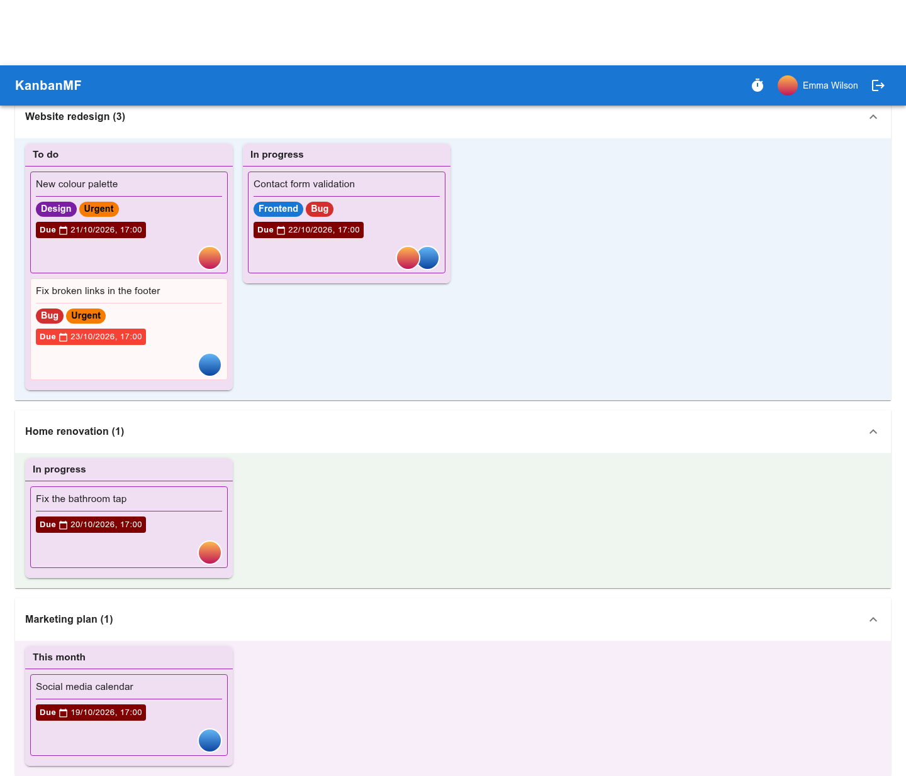

Overdue tasks
=============

The overdue tasks page gathers, in one place, every card that is past its due
date on every board you can see — the boards you own and the ones shared with
you. Open it with :guilabel:`Show Overdue Tasks` at the bottom of the boards
overview.

   Overdue tasks on three boards.

A card counts as overdue when its due date has passed and it has **no end
date**. Giving a card an end date marks it as finished and takes it off this
page. Archived cards, lists and boards, and templates, are left out. This is
the same rule the :doc:`e-mail reminders <notifications>` use.

How the page is laid out
------------------------

- One section per board, the board with the most overdue cards first. The
  number next to the board's name is how many it has. Click a section's
  title to fold it.
- Inside each board, the lists that have overdue cards, in the board's own
  order.
- Inside each list, the cards, oldest due date first.

Boards, lists and cards keep the colours you gave them, and the cards look
the same as on the board.

Click a card to open it on its board, ready to edit — to give it a new due
date, an end date, or whatever it needs. :guilabel:`Back to Boards` returns
to the overview.
