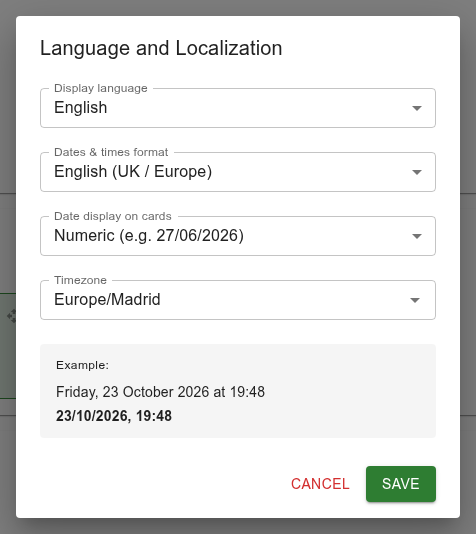
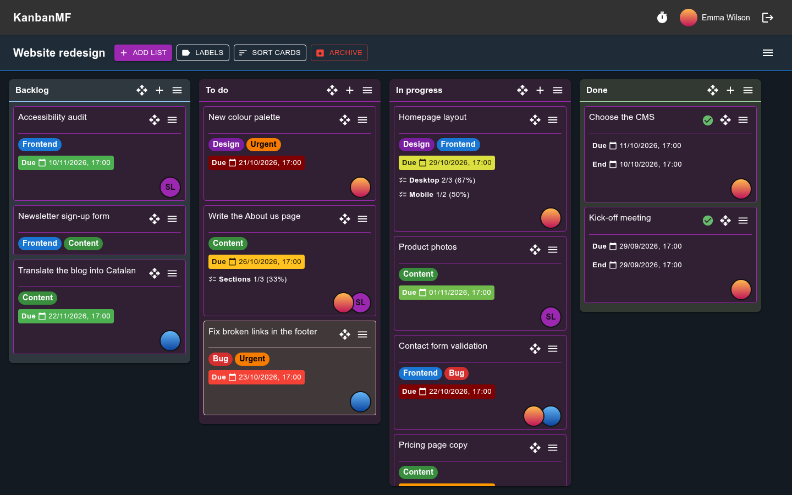
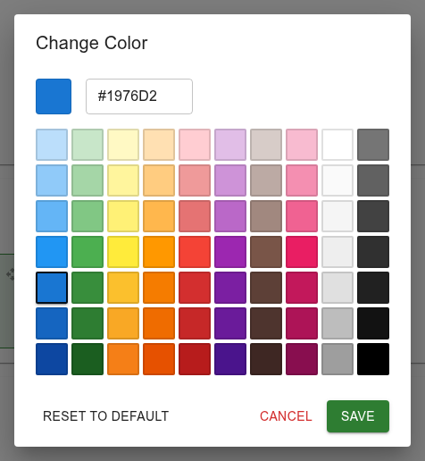

Personal preferences
====================

Language, dates and time zone
-----------------------------

Open the user menu (your name in the top bar) and choose
:guilabel:`Language and Localization`.

   Language and localisation.

:guilabel:`Display language`
   English or Catalan: the language of every screen. Reminder e-mails use it
   too.

:guilabel:`Dates & times format`
   How dates, times and numbers are written: *English (US)*, *English (UK /
   Europe)* or *Català*. It is independent of the display language — you can
   use the app in English with European dates.

:guilabel:`Date display on cards`
   *Numeric* (27/06/2026) or *Textual* (27 June 2026), for the dates shown on
   card faces.

:guilabel:`Timezone`
   Your time zone. Dates and times are shown in it, and it decides when your
   e-mail reminders go out (see :doc:`notifications`). Type to search the
   list. When you have never chosen one, your browser's time zone is used.

The box at the bottom shows today's date in the chosen format, so you can see
the effect before you click **Save**. These preferences belong to your
account, so they follow you to every device.

Light and dark theme
--------------------

Choose :guilabel:`Change to Dark Theme` in the user menu, and
:guilabel:`Change to Light Theme` to switch back. The sign-in page has the
same switch, as a moon or sun icon at the top right.

   The dark theme.

The theme is remembered **per browser**, not per account: you can use the
dark theme on one computer and the light one on another.

.. _manual-colours:

Colours
-------

Boards, lists and cards can each have a colour. Colours are there to make
your boards easier to read at a glance: a colour per project, a colour for
the *Done* list, a red card for something that must not be forgotten.

Choosing a colour
~~~~~~~~~~~~~~~~~

Choose :guilabel:`Change Color` from the menu of a board's tile (see
:doc:`boards`), of a list, or of a card (see :doc:`cards`).

         colour code and a Reset to default button.

   Choosing a colour.

Pick one of the colours in the grid — ten hues from light to dark — or type
any colour code, such as ``#1976D2``, in the box at the top. Click **Save**
to keep it. :guilabel:`Reset to default` removes your choice, and the board,
list or card goes back to the default look.

What each colour changes
~~~~~~~~~~~~~~~~~~~~~~~~

A board's colour
   Tints the board's tile on the boards overview, the bar under the board's
   name, and the background of the board page. On the overdue tasks page it
   tints the board's section.

A list's colour
   Tints the list's header and the area that holds its cards.

A card's colour
   Tints the card and its border.

The colours are applied as light tints, so text stays easy to read, and they
adapt to the theme: the same colour works in the light and the dark theme.

With no colour chosen, the board page, its lists and its cards use a light
purple tint; on the boards overview, a board without a colour has a plain
tile.

Your colours are yours alone
~~~~~~~~~~~~~~~~~~~~~~~~~~~~

Colours are **personal**: they change what *you* see, and nothing else.
Someone you share a board with sees their own colours, or the default ones,
and can colour the same board, lists and cards differently without changing
what you see. Neither the owner nor anyone else can choose colours for you.

Colours that are set for you
~~~~~~~~~~~~~~~~~~~~~~~~~~~~

A few actions give something a colour straight away, from the colours you
already chose:

- A **new list** takes the colour you gave its board.
- A **new card** takes the colour you gave its list.
- A **board created from a template** takes the board and list colours you
  gave the template (see :doc:`templates`), and so does a duplicated
  template.
- A **copied card**, or a card made from a checklist item, takes the
  original card's colour.

This only happens at that moment, and only for you: changing a board's colour
later doesn't recolour its lists, and the other people on the board see the
new list or card in their own colours. If you haven't chosen a colour for the
board or list in question, the new one keeps the default look.
