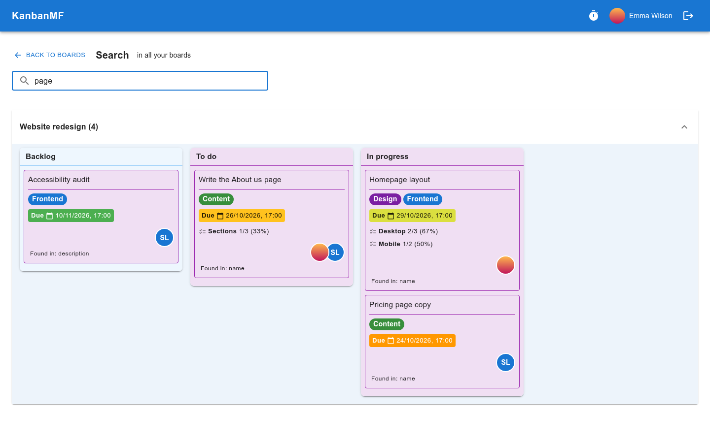

Searching
=========

The search finds cards by the words in them. Where it looks depends on where
you start it:

- on the **boards overview**, in every board you can see — the boards you own
  and the ones shared with you;
- on a **board**, in that board only;
- in a board's **archive**, in that board's archived cards and archived lists
  (see :ref:`manual-archive`);
- in the **Archived Boards** section of the overview, in your archived boards.

Starting a search
-----------------

On the boards overview and on a board, the search box is in the top bar: its
placeholder says where it looks, :guilabel:`Search all boards` or
:guilabel:`Search this board`. Type what you are looking for and press
:kbd:`Enter`. On a phone the box is a magnifier icon; tap it to open the box.

         boards and a note under each card saying where the word was found.

   Searching every board.

What is searched
----------------

A card is found when **every word** you type appears somewhere in it, in any
of:

- its name;
- its description;
- its checklists — their names and their items;
- the names of its labels.

Capital letters and accents don't matter: *cafe* finds *Café* and *cafè*. The
search needs at least two characters.

Only cards that are on the board are searched: archived cards, the cards of
archived lists and archived boards are left out — they have searches of their
own, see below. Templates hold no cards, so there is nothing to find on them.

The results
-----------

The results page is laid out like the :doc:`overdue tasks page <overdue>`:

- one section per board, the board with the most matches first, with the
  number of matches next to its name;
- inside each, the lists that hold a match, in the board's own order;
- inside each list, the matching cards in the list's order.

Under each card, :guilabel:`Found in` says which part of it matched — useful
when the word is in the description or a checklist, which the card doesn't
show. A search started on the overview also lists, under
:guilabel:`Boards`, the boards whose name holds your words; click one to open
it.

Click a card to open it on its board, ready to edit. The search box at the
top of the page refines the search as you type, and the button at the top
left takes you back to where you started. The page follows changes as they
happen, so a card edited by someone else drops in or out of the results by
itself.

If a search matches more than 200 cards, only the 200 changed most recently
are shown, with a note saying so: add a word to narrow it down.

Searching the archives
----------------------

Archived cards have searches of their own, so that they never clutter the
everyday ones:

A board's archive
   Open the board's :guilabel:`Archive` view: the box in the top bar
   becomes :guilabel:`Search this board's archive`. It finds the board's
   archived cards and the cards of its archived lists. Clicking a result
   takes you back to the archive view, where the card is outlined for a few
   seconds; restore it from there if you need it.

   .. figure:: img/search-archive.png
      :alt: The search results for a board's archive, with one archived card.

      Searching a board's archive.

Your archived boards
   Click :guilabel:`Show Archived Boards` at the bottom of the overview. The
   section that opens has its own box, :guilabel:`Search archived boards`,
   which finds every card on your archived boards — archived or not, since
   on an archived board everything counts as archived — and the archived
   boards whose name matches. An archived board can't be opened, so
   clicking a result takes you back to the Archived Boards section, where you
   can restore the board. Only a board's owner sees it once it is archived,
   so this search only covers your own boards.
