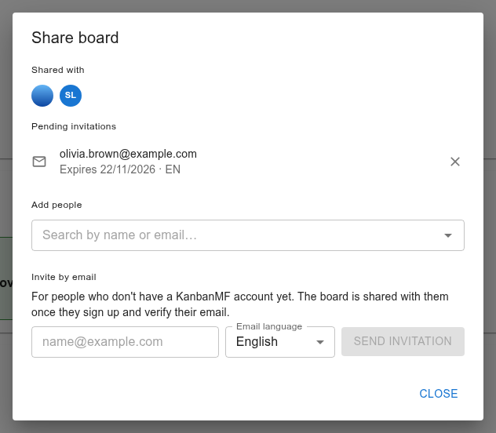
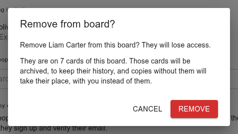

Sharing a board
===============

A board you create is yours alone until you share it. Sharing gives other
people access to the board — its lists, cards, checklists and labels — so
you can work on it together.

The share dialog
----------------

On the boards overview, open the board's menu (☰) and choose
:guilabel:`Share`. Only the board's owner has this option.

         the fields to add more.

   The share dialog.

:guilabel:`Shared with`
   The people who already have access. Click an avatar to remove that person
   (see below).

:guilabel:`Pending invitations`
   Invitations sent to people who don't have an account yet.

:guilabel:`Add people`
   Find someone with a KanbanMF account and pick them to share the board with
   them straight away. Type part of their name if you already share a board
   with them (either way round); anyone else is found only by their full
   e-mail address. That way nobody can use this box to find out who else has
   an account. For the same reason, full addresses can only be looked up a
   limited number of times an hour (about a hundred); past that the box says
   "Too many attempts" for a while.

:guilabel:`Invite by email`
   For someone who has no account yet.

Inviting someone without an account
-----------------------------------

Type their e-mail address under :guilabel:`Invite by email`, choose the
language of the invitation e-mail, and click :guilabel:`Send invitation`.
They get an e-mail with a link to sign up; once they create their account
with that address and verify it, the board appears under
:guilabel:`Shared with me` for them, without you doing anything else (see
:doc:`accounts`).

If the address already belongs to a KanbanMF user, the dialog says so and
offers to share the board with them directly.

A pending invitation lasts 30 days. Click the cross next to it to cancel it;
the link in the e-mail then stops working.

Invitations need the server to be able to send e-mail. If it can't, the
dialog says so and only :guilabel:`Add people` is available. Templates can
only be shared with existing users, never by invitation.

What shared users can do
------------------------

People a board is shared with work on it almost like its owner. They can:

- add, rename, reorder and archive lists;
- create, edit, move, copy and archive cards, and work with checklists;
- attach the board's labels to cards;
- restore archived lists and cards.

Only the owner can rename, share, archive or delete the board, manage its
labels, or delete archived lists and cards permanently.

Each person's view is their own
-------------------------------

Some settings only ever affect the person who chooses them:

- board, list and card **colours**;
- the **order** of boards on the overview, and **stars**;
- how cards are **sorted** on a board;
- **e-mail reminders** (see :doc:`notifications`).

So two people can look at the same board in different colours and arranged
differently, and neither of them changes what the other sees.

Removing someone
----------------

In the share dialog, click the person's avatar under :guilabel:`Shared with`.
The confirmation tells you how many of the board's cards they are on.

         cards they are on and what will happen to them.

   Removing someone who is on seven cards.

When you confirm, they lose access straight away, the board disappears from
their overview, and their e-mail reminders for it are switched off. Then, so
that the board holds no one who can't open it, each card they are a member
or assignee of is **replaced**:

- the card is archived exactly as it was, people included, to keep its
  history;
- a copy takes its place, in the same list and position, with the same
  name, description, dates, labels and checklists, and with everyone's
  colours. On the copy, **you take their place** as member or assignee, and
  you are its creator.

Only cards still on the board are replaced: archived cards, and the cards of
an archived list, keep the person. See :ref:`manual-archive` for what happens
when you try to restore one of them.

A card on which they only appear as the creator is not replaced, and still
shows them as its creator.

Working at the same time
------------------------

Everyone who has a board open sees the others' changes as they happen: a
card being added, moved, edited or archived shows up without reloading the
page.

When two people change the same card at almost the same moment, the last
change saved wins. If you keep a card's dialog open while someone else edits
that card, saving it can overwrite their changes, so close and reopen a card
that someone else may be working on.
