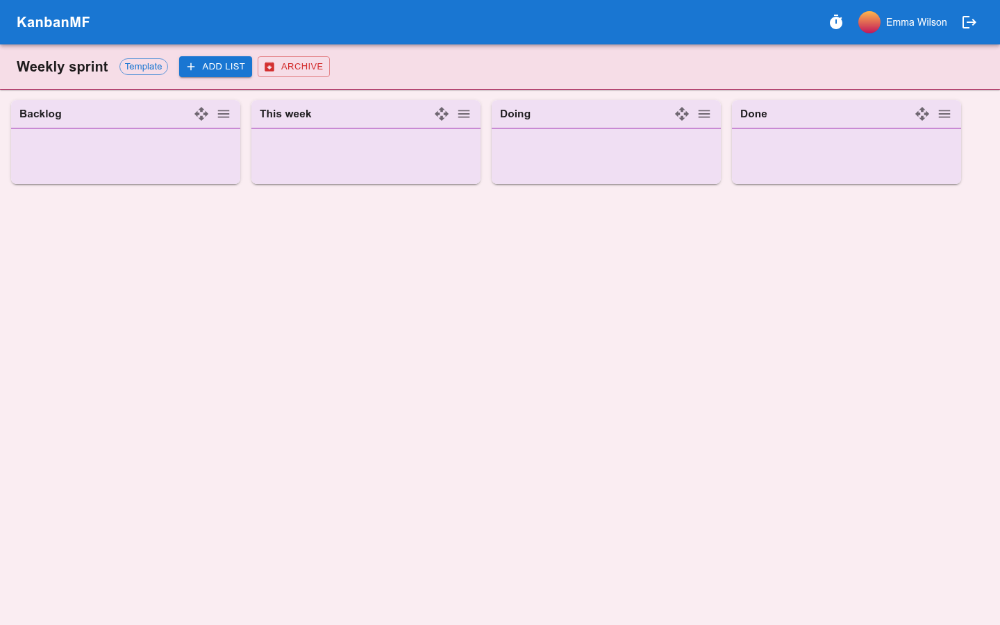

Templates
=========

A template is a board that holds only lists — no cards and no labels. When
you start the same kind of project again and again, such as a weekly sprint
or a client onboarding, a template saves setting the lists up every time.

Creating a template
-------------------

In the :guilabel:`Templates` section of the boards overview, click
:guilabel:`New Template`, give it a name and click **Save**. It opens like any
board, marked :guilabel:`Template`.

   A template.

Add, rename, recolour and reorder its lists exactly as on a board (see
:doc:`boards`). Lists on a template have no **+** button, because a template
has no cards. Give the template and its lists the colours you want new boards
to start with.

Using a template
----------------

When you create a board, choose the template in the :guilabel:`Template` box
of the :guilabel:`Create a new Board` dialog (see :doc:`boards`). The new
board gets:

- a copy of the template's lists, in the same order;
- the board and list colours *you* chose on the template. Anyone else gets
  their own colours, or the default.

The board and the template are independent from then on: changing the
template later doesn't change boards already made from it.

Templates other people shared with you are offered too, marked with their
owner's name.

The template menu
-----------------

A template's tile has the same menu as a board's (see :doc:`boards`), with
one addition:

:guilabel:`Duplicate`
   Make a copy of the template, under a new name. The copy is a new template
   that only you can see: it gets the lists and your own colours, but not the
   people the original is shared with.

There are two differences in what you can do with a template:

- It can only be shared with people who already have a KanbanMF account,
  never by e-mail invitation.
- It has no e-mail notifications, since it has no cards.

:guilabel:`Archive Template` moves it to the archived boards, where
:guilabel:`Restore Template` brings it back and :guilabel:`Delete Template`
deletes it permanently. Boards made from it are not affected.
