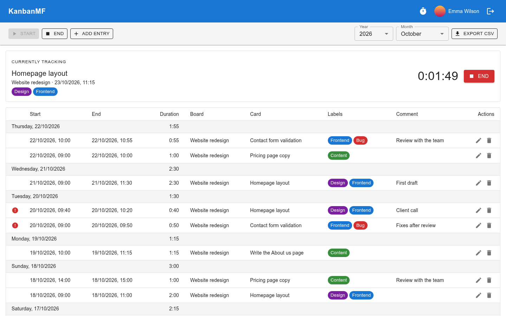
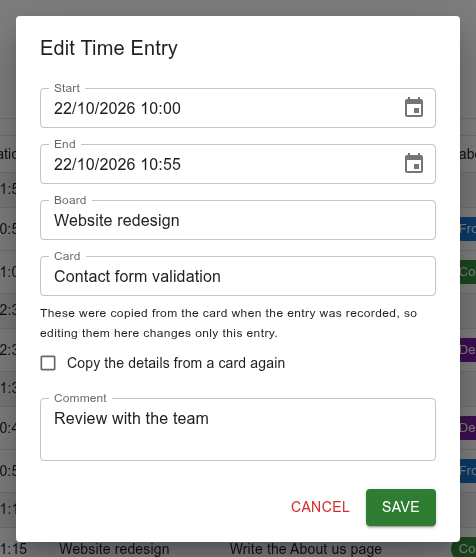

Time tracker
============

The time tracker records how long you spend on which card: start a task when
you begin, end it when you stop, and the time is logged. Your time entries are
**private** — nobody else can see them, not even the owner of the board the
card is on.

Click the timer icon in the top bar to open it.

         grouped by day.

   The time tracker.

Tracking a task
---------------

Click :guilabel:`Start`, then choose the board, the list and the card you are
going to work on. Boards and lists you have tracked time on most in the last
three months are offered first. Add a comment if you like — what this
stretch of work is about — and click :guilabel:`Start`.

The task appears under :guilabel:`Currently tracking`, with a running clock.
Click :guilabel:`End` when you stop. Only one task can run at a time: end the
current one before starting the next.

If you start a task within five minutes of ending the previous one, it is
recorded as starting exactly when the previous one ended. The moment spent
switching between tasks is not left as a gap.

Adding an entry afterwards
--------------------------

Forgot to start the clock? Click :guilabel:`Add entry` and fill in the start
and end times, the card and a comment yourself. The start is filled in for
you: if your last task ended less than an hour ago, it starts where that one
ended; otherwise, an hour ago. The end is now.

Editing and deleting entries
----------------------------

Every row has a pencil to edit the entry and a bin to delete it.

   Editing an entry.

An entry keeps a **copy** of the board name, card name and labels as they
were when the time was recorded. Renaming, archiving or deleting the card
later doesn't change your past entries — and editing those details here
changes only this entry, not the card. To pick the details up from a card
again, tick :guilabel:`Copy the details from a card again` and choose it.

Reading the table
-----------------

Choose a :guilabel:`Year` and a :guilabel:`Month` — or
:guilabel:`All months` — at the top right. Entries are grouped by day, newest
first, with each day's total on its heading row.

A red warning icon marks an entry that **overlaps** another one: two stretches
of work that claim the same minutes. Edit the times of one of them to fix it.

Exporting
---------

:guilabel:`Export CSV` downloads the entries shown — the year and month you
chose — as a spreadsheet file. It has one row per entry with the start, the
end, the duration both as hours and minutes (``2:05``) and as decimal hours
(``2.08``), the board, the card, the labels and the comment.
